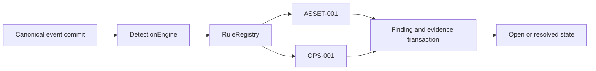

# Detection Engine

Milestone 3 began on 2026-11-09. The first implementation provides a rule protocol/registry, two telemetry-supported rules, durable findings, evidence links, configurable counting windows, and an open-to-resolved finding lifecycle. The rule catalog records coverage and remaining telemetry dependencies. [Rule catalog](../monitoring/detection-rules.md)

## Runtime Boundary

`RuntimePersistence` owns the registry, engine, and finding repository. After a successful canonical save, it evaluates the stored event. The engine verifies the supplied event against canonical history before invoking the registered rules. Direct use of `SecurityEventRepository.save()` requires an explicit `DetectionEngine.process(stored_event)` call when detection is desired.

Canonical commit precedes finding persistence. Each rule and finding write has an independent failure boundary, with safe error classification in logs. Canonical/legacy evidence can survive a failed detection attempt. An explicit replay can retry evaluation. Evaluation uses current inventory trust and currently retained canonical history, so replay results reflect those inputs at evaluation time. Ingestion and detection remain synchronous and can delay a poll during slow storage operations.

Offline validation can explicitly call `DetectionEngine.process(event, strict=True)`
to propagate the first rule or finding-write exception. The default remains
best-effort, and runtime ingestion does not enable strict mode. Strict evaluation
can leave earlier findings committed in its caller-owned database; it does not
make the entire rule pass transactional. The
[labelled evaluator](../development/labelled-activity-evaluation.md) uses isolated
storage and treats such an exception as an evaluation failure.

The existing device event bus supplies legacy alerts and notifications. Detection findings are available through the repository, a scoped `/findings` list, and `/finding` detail inspection. Allowlisted operators can resolve findings with an audited reason. API integration, acknowledgement, and incident workflows are later work. The current callbacks and history interfaces are described in the event contract. [Canonical events](security-events.md)

## Rule Contract and Configuration

`DetectionRule` exposes a nonempty `rule_id`, positive integer `version`, and `evaluate(event, assets=..., events=...)`. Evaluation returns either a validated `DetectionFinding` or `None`. The engine checks the finding's rule identity and scope against the registry/event.

`RuleRegistry` rejects duplicate rule IDs and invalid registrations and returns a tuple snapshot of its rules. Configure the registry before concurrent ingestion. Built-in rules use immutable constructor configuration.

`sentinel start` and `sentinel bot start` accept `--collector-failure-threshold` and `--collector-failure-window`. The CLI validates integer bounds before loading configuration, then passes the immutable OPS-001 policy through `run_runtime()` and `create_runtime()` to the shared runtime registry. Defaults remain 3 failures and 300 seconds. Python callers can pass `collector_failure_rule=CollectorFailureRule(...)` to either runtime factory. [Startup options](../commands.md#local-cli)

`RuntimePersistence(..., detection_rules=None)` selects the shared `default_rules()` registry containing ASSET-001, OPS-001, NET-001/002/003, and AUTH-001/002. Supplying a rule sequence replaces that default registry, and an empty sequence disables rule evaluation.

`default_rules(activity_rules=(ActivityRule(...), ...))` overrides selected activity policies while preserving registry order and all other defaults. Duplicate IDs and values other than `ActivityRule` are rejected. Startup, import, and host-watch CLI workflows expose these settings through `--activity-rule RULE=COUNT/SECONDS`. Both runtime factories accept `activity_rules` for Python callers. `HostMonitor` materializes an optional `detection_rules` iterable once and reuses it across connection recovery. Policy changes affect later evaluation and explicit replay. Stored findings retain their original settings, evidence, and resolution state.

`ActivityRule` implements the five traffic/authentication/denial policies against explicitly validated canonical evidence. Distinct-value queries select one newest representative per port, destination, or source before applying the threshold limit. `RuntimePersistence.ingest_security_event()` accepts a validated event in the configured scope, preserves explicit associations, commits canonical evidence, and dispatches isolated detection evaluation. Import callers own canonical ingestion errors. [Activity contracts and default policies](activity-evidence.md)

Collector thresholds accept integers from 1 through 500. Windows accept integer seconds from 1 through 86400. Boolean and fractional inputs are rejected. UTC event-time windows align to the Unix epoch and include their start while excluding their end. Evidence queries intersect scope, source, collector, event type, and window, and return at most the configured threshold.

Counting covers distinct stored `collector.error` IDs across a fixed window. Recovery events contribute no failure evidence. Failed polls separated by successful polls can still reach the threshold within that window. Late arrivals can complete an older window because evaluation queries the whole stored window. Timestamp range boundaries are clipped to representable UTC datetimes.

## Finding Contract and Deduplication

`DetectionFinding` is a frozen version-1 value containing rule ID/version, scope, grouping key, severity, summary, source/collector, optional asset ID, UTC evidence time range, unique evidence IDs, threshold, and optional window settings. Evidence IDs are copied into a sorted tuple and bounded at 500. Serialization validates the full field set and verifies its derived identity.

The ID hashes rule/version, scope, grouping key, threshold, window duration, and window start. `ASSET-001` groups by asset ID within scope. `OPS-001` groups by source/collector within a fixed window. Changing collector thresholds or window settings changes policy identity. Rule code changes that alter meaning require a rule-version change.

`DetectionRepository.save_once()` atomically records the finding and evidence links. The first committed finding wins for its derived ID, including its original evidence snapshot and time range. Later matching evaluations return that stored finding with `inserted=False`. Independent writers use the unique finding ID to coalesce concurrent matches. Evidence can differ between simultaneous evaluations, and the winning transaction defines the retained snapshot.

Finding timestamps describe the initial evidence snapshot. Repeated matches preserve that snapshot, and the payload records the configured threshold rather than an ongoing occurrence count. The retained `OPS-001` evidence contains the threshold number of newest matching events available at first evaluation.

## Persistence and Queries

PostgreSQL migration 4 / SQLite schema 8 add these entities through the existing versioned initialization path.

| Table | Fields and relationships |
| --- | --- |
| `detection_findings` | Finding ID primary key, indexed rule/scope/asset/evidence time, JSON payload, status, and optional resolution time |
| `detection_evidence` | Composite finding/event primary key, foreign key to the finding, indexed soft reference to canonical event ID |
| `detection_resolutions` | Finding ID primary/foreign key, operator platform and ID, reason, and resolution time; added by PostgreSQL migration 5 / SQLite schema 9 |

Inventory asset IDs and canonical event IDs are soft references. Canonical retention or inventory deletion preserves the finding and evidence IDs. Investigators may encounter evidence IDs whose source rows have expired. Finding retention and evidence retention need a coordinated deployment policy.

`get()` retrieves immutable evidence and accepts an optional exact `network_scope` filter. Operator detail queries always supply that scope before reading lifecycle state. `query()` intersects scope, rule, asset, evidence event, and status filters. Results default to 50, with integer limits from 1 through 500, ordered by original `last_seen` then finding ID descending. Missing filters span their dimension. Internal callers supply their scope and access policy, and operator commands apply their existing authorization checks.

For older pages, pass `before=FindingCursor.from_finding(last_finding)` with the same filters. The cursor uses original evidence time and finding ID as an exclusive ordering key, including equal-time ties. The command layer serializes versioned, bounded URL-safe tokens and rejects malformed fields, versions, timestamps, and IDs before querying. Cursors supply positions within the caller's scoped query. Pages can reflect concurrent inserts or lifecycle changes between requests.

The integrated command handler exposes `/findings` through the existing Discord/Telegram allowlists and rate limits. The handler requires an explicit runtime scope, defaults to five open findings, and allows `open`, `resolved`, or `all` status with a limit from 1 through 5. It queries one additional row to determine whether to emit a next-page command. Query and state reads can observe concurrent resolution between calls. Failed state reads discard the partial response. [Finding commands](../commands.md#detection-findings)

`/finding <finding-id>` adds bounded detail inspection. It returns source/collector labels, the asset reference, original evidence time range, current resolution state, rule version and policy parameters, and up to three evidence IDs. Available canonical rows contribute only event type, timestamp, and subject IP to the display. Exact-scope lookup prevents another scope's finding from reaching the response or lifecycle lookup. Unknown/out-of-scope IDs share one response. Long display values are bounded and long evidence IDs receive an omission marker.

`list_evidence(finding_id, network_scope=..., limit=50)` returns retained event references paired with currently stored same-scope canonical rows, or `None` for unavailable rows. Limits range from 1 through 500. The query guards both finding scope and event scope, including IDs reused in another scope after canonical retention. Original finding payloads and reference lists are retained independently of source row availability. Reuse of an expired event ID in the same scope can link to a newer canonical representation. Original full-payload archival requires a separate retention contract.

## Lifecycle

New findings have `open` state. `get_state()` retrieves their separate immutable state value. `resolve(finding_id, resolved_at=aware_datetime)` moves an open finding to `resolved`. Resolution time must be at or after the latest retained evidence time. The first committed resolution time wins across retries and concurrent callers.

Resolution preserves the evidence payload. Replay retains the resolved state. A later `OPS-001` time window can generate a new finding under its own ID. Resolution of `ASSET-001` retains its one-finding-per-asset/scope policy. Updating inventory trust affects future evaluations.

`resolve_audited()` requires an exact network scope, Discord/Telegram operator ID, a single printable reason of 1 through 500 characters, and an aware timestamp. State and audit insert commit atomically. Concurrent requests and retries retain the first committed actor, reason, and time. `get_resolution()` reads the audit only within the requested finding scope. Audit rows remain with the finding until it is deleted.

Allowlisted operators use `/resolve-finding <id> <reason>` or Discord `/resolve_finding`. Authorization and rate limits precede storage access. `/finding` shows the recorded operator and reason. Unknown and out-of-scope IDs share a response. Historical resolutions created through the internal `resolve()` method retain their original state and attribution remains unavailable. Migration and repeated resolution preserve that history.

Acknowledgement, reopening, automatic recovery-driven closure, and incident correlation remain future lifecycle work. An open historical failure finding can coexist with a currently recovered collector. Finding review uses the commands, and existing legacy alert delivery continues under its current rules.

## Validation and Next Work

Shared detection repository/ingestion tests run against temporary SQLite and isolated PostgreSQL schemas. They cover unique concurrent writes, lifecycle resolution races, restart/replay, rollback, additive migrations, retained soft links, trust checks, counting windows, late events, scope/source separation, and the real monitor/event/alert path with mocked collection and delivery. Contract tests cover validation, identity, wire format, and bounded policy settings. [Detection tests](../../tests/test_detection.py)

Milestone 3 remains in progress for live acceptance. All seven rule IDs, startup/standalone-discovery findings, and audited operator resolution are implemented. Traffic/authentication/denial rules have controlled synthetic evidence and an explicit import entry point. Live adapters, deployment policy attribution, labelled lab scenarios, and false-positive tuning remain acceptance gates. [Project plan](../../Sentinel_Project_Plan.md)
