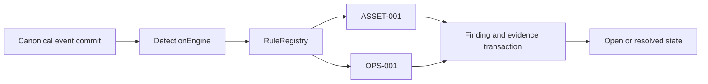

# Detection Engine

Milestone 3 began on 2026-11-09. The first implementation provides a rule protocol/registry, two telemetry-supported rules, durable findings, evidence links, configurable counting windows, and an open-to-resolved finding lifecycle. The rule catalog records coverage and remaining telemetry dependencies. [Rule catalog](../monitoring/detection-rules.md)

## Runtime Boundary

`RuntimePersistence` owns the registry, engine, and finding repository. After a successful canonical save, it evaluates the stored event. The engine verifies the supplied event against canonical history before invoking the registered rules. Direct use of `SecurityEventRepository.save()` requires an explicit `DetectionEngine.process(stored_event)` call when detection is desired.

Canonical commit precedes finding persistence. Each rule and finding write has an independent failure boundary, with safe error classification in logs. Canonical/legacy evidence can survive a failed detection attempt. An explicit replay can retry evaluation. Evaluation uses current inventory trust and currently retained canonical history, so replay results reflect those inputs at evaluation time. Ingestion and detection remain synchronous and can delay a poll during slow storage operations.

The existing device event bus supplies legacy alerts and notifications. Detection findings are available through the repository and a scoped `/findings` command. Delivery policy, API integration, acknowledgement, and incident workflows are later work. The current callbacks and history interfaces are described in the event contract. [Canonical events](security-events.md)

## Rule Contract and Configuration

`DetectionRule` exposes a nonempty `rule_id`, positive integer `version`, and `evaluate(event, assets=..., events=...)`. Evaluation returns either a validated `DetectionFinding` or `None`. The engine checks the finding's rule identity and scope against the registry/event.

`RuleRegistry` rejects duplicate rule IDs and invalid registrations and returns a tuple snapshot of its rules. Configure the registry before concurrent ingestion. Built-in rules use immutable constructor configuration.

`RuntimePersistence(..., detection_rules=None)` selects `UnknownAssetRule()` and `CollectorFailureRule(threshold=3, window_seconds=300)`. Supplying a rule sequence replaces that default registry, and an empty sequence disables rule evaluation. These are application constructor settings. Configuration and environment files retain their existing interface.

Collector thresholds accept integers from 1 through 500. Windows accept integer seconds from 1 through 86400. Boolean and fractional inputs are rejected. UTC event-time windows align to the Unix epoch and include their start while excluding their end. Evidence queries intersect scope, source, collector, event type, and window, and return at most the configured threshold.

Counting covers distinct stored `collector.error` IDs across a fixed window. Recovery events contribute no failure evidence. Failed polls separated by successful polls can still reach the threshold within that window. Late arrivals can complete an older window because evaluation queries the whole stored window. Timestamp range boundaries are clipped to representable UTC datetimes.

## Finding Contract and Deduplication

`DetectionFinding` is a frozen version-1 value containing rule ID/version, scope, grouping key, severity, summary, source/collector, optional asset ID, UTC evidence time range, unique evidence IDs, threshold, and optional window settings. Evidence IDs are copied into a sorted tuple and bounded at 500. Serialization validates the full field set and verifies its derived identity.

The ID hashes rule/version, scope, grouping key, threshold, window duration, and window start. `ASSET-001` groups by asset ID within scope. `OPS-001` groups by source/collector within a fixed window. Changing collector thresholds or window settings changes policy identity. Rule code changes that alter meaning require a rule-version change.

`DetectionRepository.save_once()` atomically records the finding and evidence links. The first committed finding wins for its derived ID, including its original evidence snapshot and time range. Later matching evaluations return that stored finding with `inserted=False`. Independent writers use the unique finding ID to coalesce concurrent matches. Evidence can differ between simultaneous evaluations, and the winning transaction defines the retained snapshot.

Finding timestamps describe the initial evidence snapshot. Repeated matches preserve that snapshot, and the payload records the configured threshold rather than an ongoing occurrence count. The retained `OPS-001` evidence contains the threshold number of newest matching events available at first evaluation.

## Persistence and Queries

PostgreSQL migration 4 / SQLite schema 8 add these entities through the existing versioned initialization path.

| Table | Fields and relationships |
| --- | --- |
| `detection_findings` | Finding ID primary key, indexed rule/scope/asset/evidence time, JSON payload, status, and optional resolution time |
| `detection_evidence` | Composite finding/event primary key, foreign key to the finding, indexed soft reference to canonical event ID |

Inventory asset IDs and canonical event IDs are soft references. Canonical retention or inventory deletion preserves the finding and evidence IDs. Investigators may encounter evidence IDs whose source rows have expired. Finding retention and evidence retention need a coordinated deployment policy.

`get()` retrieves immutable evidence. `query()` intersects scope, rule, asset, evidence event, and status filters. Results default to 50, with integer limits from 1 through 500, ordered by original `last_seen` then finding ID descending. Missing filters span their dimension. Internal callers supply their scope and access policy, and operator commands apply their existing authorization checks.

The integrated command handler exposes `/findings` through the existing Discord/Telegram allowlists and rate limits. The handler requires an explicit runtime scope, defaults to five open findings, and allows `open`, `resolved`, or `all` status with a limit from 1 through 5. Query and state reads can observe concurrent resolution between calls. Failed state reads discard the partial response. [Finding commands](../commands.md#detection-findings)

## Lifecycle

New findings have `open` state. `get_state()` retrieves their separate immutable state value. `resolve(finding_id, resolved_at=aware_datetime)` moves an open finding to `resolved`. Resolution time must be at or after the latest retained evidence time. The first committed resolution time wins across retries and concurrent callers.

Resolution preserves the evidence payload. Replay retains the resolved state. A later `OPS-001` time window can generate a new finding under its own ID. Resolution of `ASSET-001` retains its one-finding-per-asset/scope policy. Updating inventory trust affects future evaluations.

The internal resolution method requires an explicit caller and timestamp. Operator authorization for state changes, actor/reason audit records, acknowledgement, reopening policy, automatic recovery-driven closure, notifications, and incident correlation require subsequent lifecycle design. An open historical failure finding can coexist with a currently recovered collector.

## Validation and Next Work

Shared detection repository/ingestion tests run against temporary SQLite and isolated PostgreSQL schemas. They cover unique concurrent writes, lifecycle resolution races, restart/replay, rollback, additive migrations, retained soft links, trust checks, counting windows, late events, scope/source separation, and the real monitor/event/alert path with mocked collection and delivery. Contract tests cover validation, identity, wire format, and bounded policy settings. [Detection tests](../../tests/test_detection.py)

Milestone 3 remains in progress. Next are coverage decisions for startup inventory and standalone discovery, finding delivery and audited state-change requirements, and rule contracts for scan/authentication/restricted-access telemetry. Those rule families depend on later collection capabilities described in the project plan. [Project plan](../../Sentinel_Project_Plan.md)
